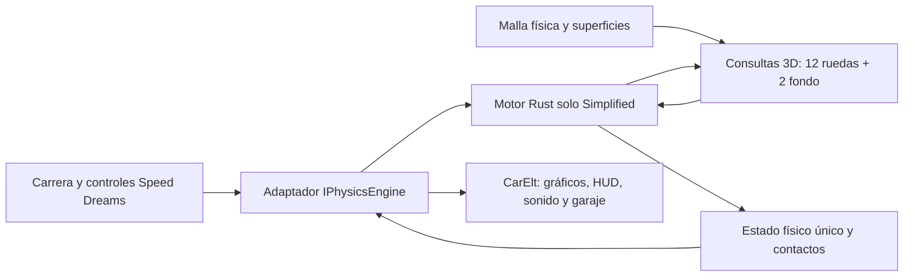

# Evaluación: físicas Rust simplificadas de Formula90s en Open Formula

Fecha: 21 de octubre de 2026. Evaluación de fuentes y contratos; no es una implementación ni una promoción de binarios.

Origen leído: `D:/Formula90s`, HEAD `f3efcf246c2a2abf62477037ed0243f2f9a93a9b`. Destino: `D:/open-formula`, HEAD `a68ee9e`, con los cambios locales de las tareas anteriores preservados.

## Dictamen

**Es viable reutilizar la lógica física Rust y mantener 3 raycasts por rueda más 2 del fondo. No basta con copiar la DLL.** La lógica de vehículo no depende de Godot; la ruta de juego actual sí depende de Godot para muestreo, integración del cuerpo y respuesta a colisiones. Hay integración autónoma de chasis en Rust que se puede aprovechar, pero no incluye por sí sola todas las colisiones de un simulador.

El objetivo debe ser un motor físico Rust autónomo, implementando la interfaz `IPhysicsEngine` de este repositorio mediante un adaptador C++. Speed Dreams conserva carrera, controles físicos del dispositivo, gráficos, HUD, sonido y garaje. Rust pasa a poseer los estados físicos y su avance. No se deben ejecutar el motor Rust y los integradores/fuerzas de simuv5 sobre el mismo coche.

El alcance «únicamente simplificada» se interpreta como la combinación que utiliza `scripts/run_f1_97.ps1`: suspensión simplificada, aerodinámica simplificada, neumático simplificado **con relajación** y estados térmicos simplificados. No equivale a seleccionar `VehicleDynamicsFidelity::Simplified`, que corresponde a otra ruta orientada a IA y al mundo acoplado.

Hay dos decisiones previas del destino que el port literal no conservaría:

- El Rust simplificado actual tiene neumático elástico verticalmente. Open Formula acaba de sustituir esa elasticidad por contacto rígido. Para conservar ese requisito habría que adaptar también el contacto vertical en Rust; no es un cambio que se consiga poniendo una rigidez a cero o muy alta.
- El Rust simplificado inspeccionado no tiene un tercer muelle físico independiente por eje en su configuración de suspensión. Hay variables de heave para diagnóstico, pero no el elemento trasero de 285 kN/m que acabamos de añadir. Habría que implementarlo en el modelo simplificado y conectarlo al garaje.

## Qué está confirmado

1. `vehicle-physics-engine/Cargo.toml` produce `rlib` y `cdylib`. Sus dependencias son Rust/Parry/serde/JSON/hash/errores, sin dependencia Godot.
2. El crate físico tiene 98 archivos Rust y 36.444 líneas bajo src, incluyendo módulos internos y pruebas embebidas. Copiar todo conserva también Standard, el mundo acoplado y otras rutas; no cumple por sí solo una distribución exclusivamente simplificada.
3. `native/src/core/f90_core.cpp:599` obtiene pose/velocidades del cuerpo Godot, muestrea contactos, llama al núcleo Rust y aplica fuerza central/par al cuerpo de Godot. Esa es la dependencia que debe sustituirse.
4. `simulation.rs:300` ofrece `step_with_aerodynamics_environment`: calcula fuerzas con medidas del fondo y ejecuta `integrate_standalone`. Este último, desde línea 1108, integra velocidad/posición y orientación con cuaternión, gravedad e inercias. Es un punto de partida real, no un integrador de chasis que haya que inventar desde cero.
5. La ABI física existente es versión 15. `ffi.rs:773` expone un step autónomo, pero llama a `step`, que deshabilita las medidas del fondo. El solve externo existente tampoco recibe esas medidas. Hay que ampliar la ABI: usar esos símbolos sin más perdería la ruta del fondo.
6. `formula90-core/src/underfloor.rs` contiene fuerzas/momentos y estado de contacto del fondo. No todo ese comportamiento vive en vehicle-physics-engine. Debe separarse como física reutilizable sin arrastrar el orquestador de audio ni todo el workspace.

## Inventario y decisión de reutilización

| Grupo de origen | Función | Tratamiento propuesto |
| --- | --- | --- |
| simulation.rs, types.rs, telemetry.rs | Estado, entradas, fuerza/par, integración y telemetría | Reutilizar; fijar ejecución simplificada y publicar un snapshot completo. |
| suspension.rs, simplified_suspension.rs | Muelles/amortiguadores, topes, geometría equivalente preparada | Extraer la ruta simplificada y dependencias comunes. Mantener funciones geométricas necesarias para preparar tablas; retirar selección y evaluación Standard en ejecución. |
| simplified_axle_integration.rs, simplified_contact_kinematics.rs, vertical_suspension_integration.rs | Integración por eje, trabajo/contacto y dinámica vertical | Reutilizar con auditoría del contacto rígido requerido por el destino. |
| suspension_geo_config.rs, suspension_kinematics.rs, suspension_loads.rs y dependencias geométricas | Hardpoints, preparación de transmisión y reacciones | Conservar lo que consuma Simplified; no confundir preparación geométrica con tener un segundo backend físico activo. |
| tire.rs, wheel_mechanics.rs, static_lateral_contact.rs | Grip combinado, spin, radio y contacto mecánico | Conservar el neumático simplificado con relajación. La variante IA no es el sustituto automático del jugador. |
| powertrain.rs | Motor, caja, embrague y diferencial | Reutilizar. Traducir entradas y calibración del Williams; no ejecutar engine/transmission/differential C++ en paralelo. |
| aero.rs, simplified_aerodynamics.rs | Alas, drag y efecto suelo | Conservar tipos/configuración compartidos y solo la evaluación simplificada. |
| slow_states.rs, tire_thermals.rs, tire_wear.rs, brake_thermals.rs, powertrain_thermals.rs | Térmica, desgaste y estados lentos | Reutilizar con selección explícita simplificada y reloj coherente. |
| vehicle_configuration/, vehicle_mass_properties.rs y configuración consumida | Perfiles por dominios, carga y propiedades de masa | Reutilizar con manifiestos y datos autorizados. Resolver la masa una sola vez. |
| formula90-core/src/underfloor.rs y underfloor_contact_configuration.rs | Contacto/raspado del fondo y parámetros | Mover la parte física al paquete físico o a un módulo independiente; adaptar su entrada de contactos rígidos. |
| physical_collision_world.rs | Geometría, raycasts y contactos con Parry | Reutilizable para consultas 3D del suelo y geometría de choque. Por sí solo no integra ni resuelve respuesta. |
| generalized_vehicle_contacts.rs y mundo acoplado | Respuesta generalizada y mundo con otra arquitectura | Referencia/reutilización selectiva de algoritmos. No instalar ese mundo entero como si fuera la misma ruta simplificada de 14 raycasts. |
| formula90-core, game-sim, vehicle-audio-engine y puente Godot completos | Orquestación de sesión, sonido y presentación | No son necesarios para sustituir exclusivamente las físicas de este simulador. |

## Los 14 raycasts ya existen en la ruta de origen adecuada

`native/src/vehicle/f1_94_rust_vehicle.cpp:347` crea tres rayos transversales por rueda: interior, centro y exterior. La normalización, distancias y posiciones se calculan en el puente Godot, no dentro de Rust.

En aerodinámica simplificada, líneas 401–426 y 1738–1763, solo se activan dos medidas del fondo: índices 0 y 3. Son **centro delantero y garganta del difusor**, no necesariamente extremo delantero y extremo trasero del coche. `simplified_aerodynamics.rs` consume esos dos índices, con máscara `0b01001`.

Contrato a conservar:

- Cuatro ruedas × tres rayos reales y distintos = 12 consultas.
- Un rayo central delantero + uno en la garganta = 2 consultas adicionales.
- Cada resultado aporta impacto/no impacto, distancia desde el origen del rayo, punto global, normal y superficie.
- El contacto de rueda combina únicamente los rayos válidos; no inventar un impacto para los tres a partir de uno. La estructura TriRaycastSample usa ponderación transversal 1:2:1 en sus operaciones ponderadas.
- Muestrear con pose física actual, longitud finita y exclusión del propio coche. Mantener la orientación de los rayos respecto al chasis usada por el modelo, incluyendo inclinación.
- Si no hay suelo, publicar ausencia de impacto. No sustituirlo por la altura del último triángulo encontrado.

**El mundo acoplado nuevo no cumple hoy ese contrato:** `coupled_vehicle_world.rs:1109` realiza una consulta por rueda y en línea 1150 copia el mismo impacto a inner/center/outer. Además recorre sus cinco posiciones aerodinámicas desde línea 1179. Su selector Simplified acelera otras partes, pero no lo convierte en la ruta de 12+2 rayos requerida. Esto obliga a adaptar su muestreo si se decide reutilizar componentes de ese mundo.

### Qué sustituye al raycast Godot

El `TrackGroundMesh::sample` de Open Formula es una consulta de altura sobre la proyección horizontal de triángulos. No es un segmento 3D general: ignora triángulos cuya proyección degenera, no reproduce rayos inclinados y elige altura por proximidad a una referencia. Llamarlo tres veces no garantiza equivalencia con los raycasts del origen.

La opción preferida es importar una vez la malla física de Fuji a la geometría Rust/Parry y consultar segmentos 3D reales. El Rust ya tiene `PhysicalCollisionWorld::raycast_driveable`, con origen, dirección, longitud y normal; requiere preparar el paquete de geometría, superficies y procedencia. La aceleración espacial se construye al cargar, sin escanear todo el circuito por cada rayo. Se puede conservar track_ground_mesh como formato de entrada y reconstruir sus triángulos en el sistema de consulta, sin conservar su algoritmo de altura como sustituto silencioso.

Los 14 rayos son el presupuesto de **muestreo de ruedas y fondo**. Muros, coches y carrocería necesitan consultas geométricas/contactos adicionales, que no tienen por qué ser más raycasts. Dos rayos centrales permiten alturas y rake; no observan de forma completa un piano bajo el borde lateral del fondo. El cuerpo necesita geometría de colisión aparte si se exige respuesta completa a choques, vuelcos y apoyo sobre un lateral.

## Integración propuesta en este repositorio

El adaptador C++ implementaría `initialize`, `configureCar`, `reconfigureCar`, `updateSituation`, `updateCar`, `setCar`, `getCar` y `shutdown` de `src/interfaces/iphysicsengine.h`. El motor físico seleccionado debe ejecutar únicamente Rust. Puede existir una comparación temporal mediante selección explícita de módulos, pero cada coche debe tener un único propietario y nunca usar simuv5 como fallback oculto.

### Ciclo físico

1. Recibir comandos de conducción y reloj de carrera.
2. Consultar 12+2 segmentos desde el estado autoritativo.
3. Ejecutar suspensión, neumático, transmisión, aerodinámica y estados lentos simplificados.
4. Resolver fuerzas/contactos y avanzar una sola vez pose y velocidades del cuerpo Rust. Aplicar reacción de muros/coches/fondo sobre ese mismo estado.
5. Publicar una instantánea coherente a `CarElt`: pose, velocidades, ruedas, spin, normales, cargas, rpm, marcha, combustible, desgaste, temperaturas, presión, daños y eventos de contacto.
6. Actualizar la relación con la pista necesaria para sectores, vuelta, pits, IA y carrera, sin aplicar otra fuerza por esa actualización.

No llamar en ese camino a `SimCarPhysicsStep`, `SimEngineUpdateTq`, `SimTransmissionUpdate`, al solver vertical C++ ni a la respuesta de colisiones simuv5. Se puede reutilizar geometría, formatos y presentación, pero no sumar sus reacciones físicas a las de Rust.

`VehicleSimulator::integrate_standalone` es reutilizable para el cuerpo. Su presencia no resuelve todavía colisiones con paredes/coches ni transporte del contacto del fondo. Esos componentes tienen que quedar conectados al mismo avance físico. No se recomienda sustituir todo por el mundo acoplado nuevo antes de justificar que conserva el objetivo simplificado.

### Frontera C/Rust

Proponer una ABI específica y versionada que permita crear/destruir un mundo o vehículo, cargar un perfil resuelto, avanzar con medidas o con mundo geométrico, leer el snapshot completo, resetear y aplicar setup/servicios. La ABI vigente da base, pero hay que extenderla para los dos rayos del fondo, estado completo y configuración del tercer muelle.

Usar datos POD con tamaños explícitos, buffers con longitud, propiedad de memoria definida y errores/panics contenidos en Rust. No pasar objetos C++, Godot o colecciones Rust por la frontera. Un snapshot y un avance por tick evitan decenas de llamadas por campo.

La máquina tiene instalado Rust `x86_64-pc-windows-msvc`; Open Formula usa C++ MinGW/UCRT64. Para la primera conexión conviene DLL Rust `cdylib` más carga dinámica y ABI C, en vez de asumir que sus bibliotecas estáticas de C++ son intercambiables. La documentación oficial describe [cdylib/staticlib](https://doc.rust-lang.org/reference/linkage.html) y los [contratos FFI](https://doc.rust-lang.org/nomicon/ffi.html). Esta evaluación no ha probado todavía una carga de la DLL Rust desde el ejecutable MinGW de Open Formula.

### Coordenadas, índices y unidades

| Contrato | Open Formula / simuv5 | Rust Formula90s | Trabajo |
| --- | --- | --- | --- |
| Ejes locales | X delante, Y izquierda, Z arriba | X derecha, Y arriba, −Z delante | Transformación única de posiciones, normales, velocidades, fuerzas, pares y orientación. |
| Orden de ruedas | FR, FL, RR, RL | FL, FR, RL, RR | Permutación explícita `[1,0,3,2]`. |
| Régimen motor | Publicación tradicional en rad/s | Powertrain/telemetría con rpm | Convertir en la frontera correspondiente. |
| Temperatura/presión | Campos públicos y XML con convenciones propias | Perfiles con °C y presión manométrica en kPa en varias rutas | Documentar por campo; evitar dobles conversiones o aplicar presión absoluta como gauge. |
| Origen/CG/inercia | Referencia de chasis y statGC | Origen de perfil y centro de masa explícito | Respetar offsets y tensor; no trasladar únicamente una altura de CG. |
| Toe | Convención local recién añadida | Toe por eje con orientación física por lado | Preservar el valor del usuario. Verificar signos físicos con una prueba, no con copia de yaw. |

Para vectores en las bases indicadas, una transformación consistente es `v_Rust = (−v_SD.y, v_SD.z, −v_SD.x)`. La traslación de origen y la conjugación de bases/orientaciones se resuelven conjuntamente; esa fórmula aislada no convierte una pose completa.

## Selección exclusivamente simplificada

El código actual selecciona backends por variables de entorno y contiene Standard compilado. Hay también evaluaciones geométricas exactas de reserva si faltan ciertos datos preparados. Para cumplir la petición estricta:

- Crear un paquete/biblioteca cuyo constructor fije las cuatro variantes del lanzador simplificado. No depender del entorno del usuario.
- Fijar `TireBackend::SimplifiedWithRelaxation`, no la variante IA ni la variante sin relajación.
- Conservar geometría compartida necesaria para preparar las tablas, pero retirar las entradas y rutas de ejecución Standard. Si un perfil no puede prepararse o sale del dominio soportado, devolver un error explícito; no activar Standard.
- No transportar por defecto el mundo acoplado, el orquestador de audio, game-sim ni la GDExtension de Godot. Se necesita la lógica física y sus dependencias reales.
- Adaptar build.rs: actualmente exige Git e incrusta el perfil geométrico F1 2030 desde una ruta relativa fuera del crate. Copiar únicamente src/Cargo.toml no basta. Definir procedencia del origen y carga explícita del perfil Williams dentro de Open Formula.

No se ha hecho todavía el recorte de compilación ni un análisis exhaustivo de dependencias a nivel de símbolos; el inventario identifica los grupos que habría que separar.

## Perfil del Williams y garaje

Traer el perfil JSON original no conserva automáticamente el setup actual de Open Formula. En el port C++ ya se modificaron frenos, freno motor, diferencial, temperaturas, presión, alturas y tercer muelle. Esos cambios deben convertirse deliberadamente.

La propuesta es un perfil físico Rust versionado bajo este repositorio y un estado de setup autoritativo en Rust. XML conserva identidad/recursos y los campos de interfaz necesarios. Al aplicar el garaje, el adaptador traduce los cambios y Rust devuelve el setup realmente aceptado. Reconstruir tablas de suspensión cuando cambie su configuración; conservar o resetear térmica/desgaste/spin solo en transiciones definidas.

Casos especialmente importantes:

- Presión de freno en MPa, áreas, discos y mu C++ no son el mismo campo que max_brake_torque de Rust. Convertir a pares por rueda antes de mapear el reparto. Tampoco su diferencial o freno motor tienen equivalencia automática entre coeficientes.
- Trasladar el tercer muelle trasero de 285 kN/m como elemento dependiente del movimiento medio del eje, con fuerzas internas coherentes, precarga y ausencia de rigidez adicional en balanceo puro. Mantener su control de garaje. No sumarlo dos veces a los muelles de rueda.
- Mantener −0,1° delante y +0,3° detrás como valores locales por rueda.
- Evitar aplicar dos filtros de dirección/pedal, uno del puente actual y otro del Rust.
- Publicar todos los campos que consume el sonido actual sin incorporar por ello el motor de audio de Formula90s.
- Si se elimina simuv5 para todos los coches, cada coche necesita un perfil Rust válido. El perfil del Williams no convierte automáticamente al Cavallo ni al resto del catálogo.

## Contacto rígido: incompatibilidad que hay que presupuestar

`vertical_suspension_integration.rs:2-42` conserva una ley radial con rigidez y amortiguación. `simplified_contact_kinematics.rs` la consume como `radial_contact`. Por tanto, el hecho de llamarse Simplified no significa neumático rígido.

Para mantener el requisito vigente de Open Formula, hay que conservar las fuerzas tangenciales y térmica del simplificado y sustituir la reacción radial por una restricción unilateral. La carga normal resultante debe alimentar el grip y aplicarse una sola vez. No basta con quitar la fuerza radial, fijar deformación cero sin sustituto ni aumentar indefinidamente k.

También se debe decidir dónde se resuelven los contactos rígidos de carrocería/fondo. Los dos rayos sirven para sensado del fondo y su modelo aproximado; las geometrías de chasis/muro proporcionan la respuesta rígida completa. El Rust existente ofrece componentes para consultas y contactos, pero su conexión a esta ruta simplificada aún no está hecha.

Una copia literal sería más pequeña como trabajo, pero cambiaría esa decisión física anterior. Esta evaluación recomienda presupuestar el contacto rígido como parte del port compatible, sin dar por revocada la instrucción anterior.

## Coste técnico y secuencia

| Fase | Entrega comprobable | Dificultad relativa |
| --- | --- | --- |
| 1. Aislar fuente y datos | Paquete Rust reproducible, selección exclusivamente simplificada, perfil Williams cargado, procedencia registrada | Media |
| 2. Contratos | ABI, índices/ejes/unidades y snapshot sin Godot, tercer muelle y setup definidos | Media |
| 3. Consultas | Circuito físico y superficies importados; 14 rayos reales con pruebas en piano, pendiente y ausencia de suelo | Media |
| 4. Autoridad completa | Integración del cuerpo y respuesta a suelo/fondo/muros/coches en Rust, sin fuerzas simuv5 duplicadas | Alta |
| 5. Compatibilidad física | Contacto vertical rígido conservado y tercer muelle integrado con masa/trabajo coherentes | Alta para contacto rígido; media para tercer muelle |
| 6. Simulador | IPhysicsEngine, publicación CarElt, garaje, pits, reinicio, vuelta/sectores, HUD y sonido | Media-alta |
| 7. Aceptación | Frenadas, curvas, pianos, rasantes, vuelcos, muros, cambios de setup y rendimiento | Alta; requiere conducción |

El volumen mayor no está en escribir 14 raycasts ni en llamar a Rust desde C++. Está en colisiones/autoridad, conservar el contacto rígido y mapear los contratos de configuración/publicación. No sería honesto estimarlo como unas pocas líneas o una garantía de mejorar el manejo.

El reloj normal de carrera de este repo es de 2 ms (`RCM_MAX_DT_SIMU`, 500 Hz). Los 14 rayos implican 7.000 consultas de suelo por segundo y coche a esa frecuencia; 22 coches serían 154.000, antes de colisiones y fuerzas. Es una cuenta de consultas, no un benchmark. No trasladar tiempos de Formula90s medidos a otra frecuencia ni cambiar a 120 Hz sin revisar el reloj de carrera, controles y publicación.

## Pruebas de aceptación propuestas

- Contador de consultas: exactamente tres por rueda y dos del fondo por tick elegido; cada rayo tiene origen/dirección propios y no se duplican muestras.
- Simetría izquierda/derecha y rotación del escenario, sin convertir un momento de pitch en yaw por índices o ejes incorrectos.
- Carga estática, masa total con combustible, COM/inercia y conservación del trabajo al cambiar soporte/inclinación.
- Salida y reentrada de contacto, piano bajo una sola parte del neumático, ruedas en superficies distintas, pendiente, salto y ausencia de suelo.
- Frenada recta con marcha fija, embrague y reducciones; registrar qué rueda satura primero.
- Compresión simétrica y balanceo puro con el tercer muelle; cambio de rigidez desde garaje observado en las cargas físicas.
- Fondo, bordes, muros y vuelco: un contacto no puede recibir respuesta duplicada entre modelo de suelo y geometría rígida.
- Reinicio, pausa, colocación, boxes, combustible, neumáticos y publicación de audio/HUD sin una simulación sombra.
- Perfilado Release con un Williams; después parrilla. Registrar media y percentiles, recuentos de consultas y coste de física completo.

## Validación de esta evaluación

Se ejecutó `cargo check --lib --locked --offline` del crate físico desde su origen, con target separado en `C:/Users/bill/open-formula-rust-feasibility-20261021/target`. Terminó con salida 0, sin Godot y sin instalar binarios en ninguno de los juegos. Esto prueba comprobación/compilación del crate y sus dependencias, no carga de la DLL desde Speed Dreams ni conducción.

Las cuatro suites existentes terminaron con salida 0: **21 pruebas pasadas, 0 fallos**. Se ejecutaron con las cuatro variables de backend en simplified; cada suite también selecciona explícitamente los backends necesarios para sus comparaciones de referencia:

| Suite | Resultado |
| --- | --- |
| simplified_aerodynamics_test | 4 pasadas |
| simplified_contact_frame_invariance_test | 2 pasadas |
| simplified_contact_work_test | 5 pasadas, incluida reproducción de entradas de vuelco |
| tire_simplification_test | 10 pasadas |

Se usó el perfil de pruebas Debug, sin benchmark de rendimiento. Que esas pruebas pasen confirma una base reutilizable; no prueba el port, su nuevo adaptador, la respuesta a colisiones sin Godot ni el comportamiento al conducir en Open Formula.

Logs externos: `C:/Users/bill/open-formula-rust-feasibility-check.log` y `C:/Users/bill/open-formula-rust-feasibility-tests.log`. No se cambió código de producción, perfiles, configuración de motor ni binarios instalados. El único archivo nuevo de esta evaluación dentro de Open Formula es este informe.
